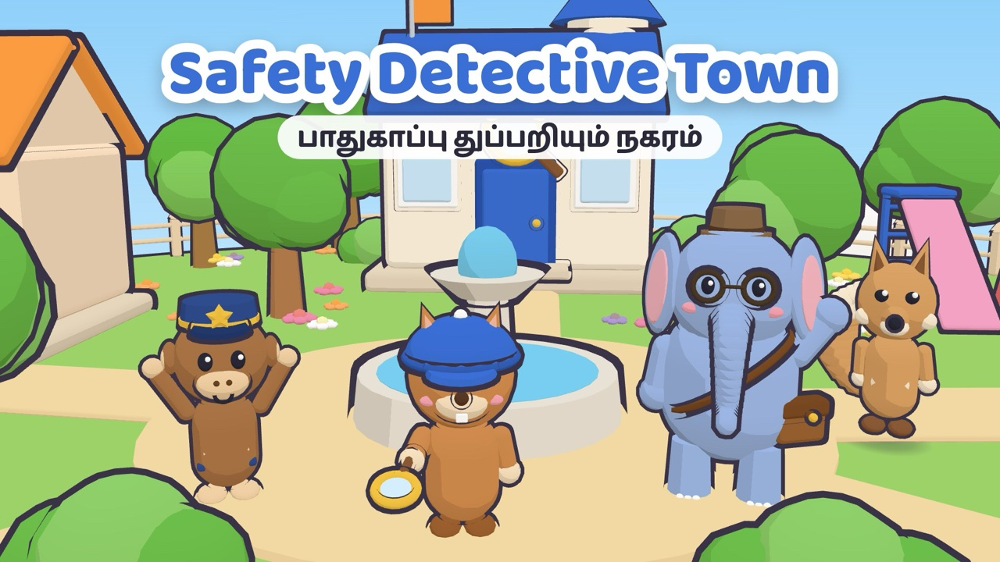
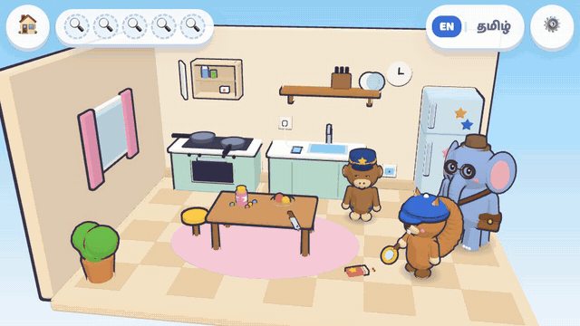
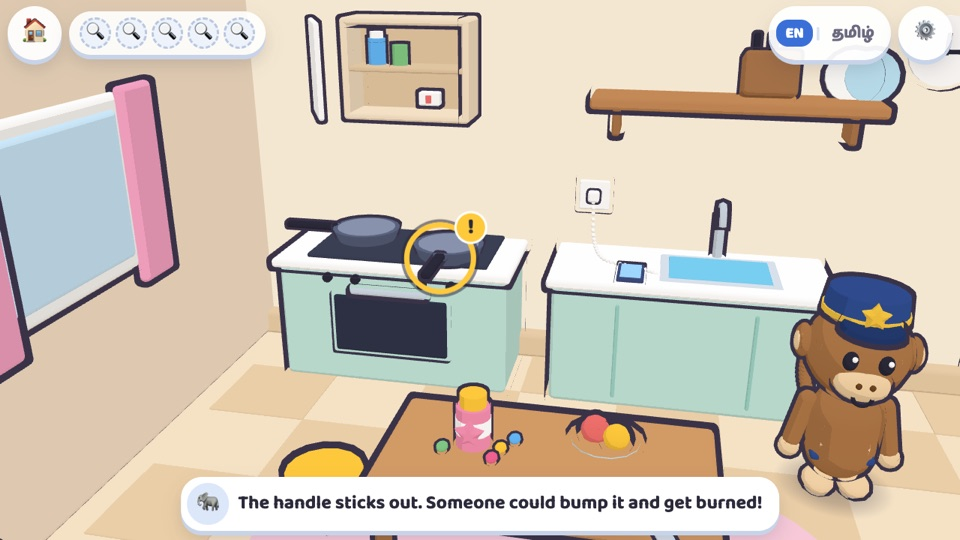
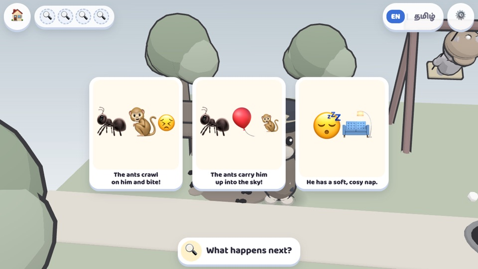
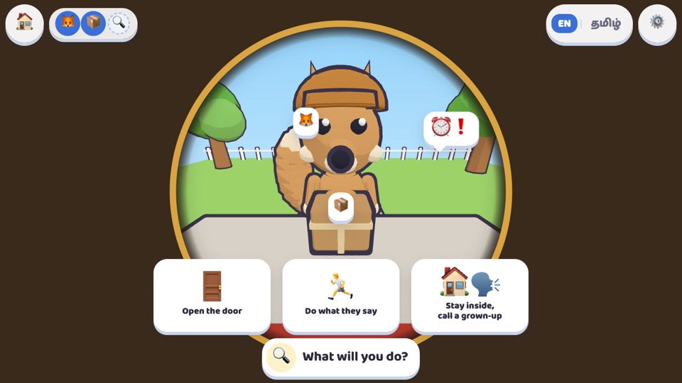
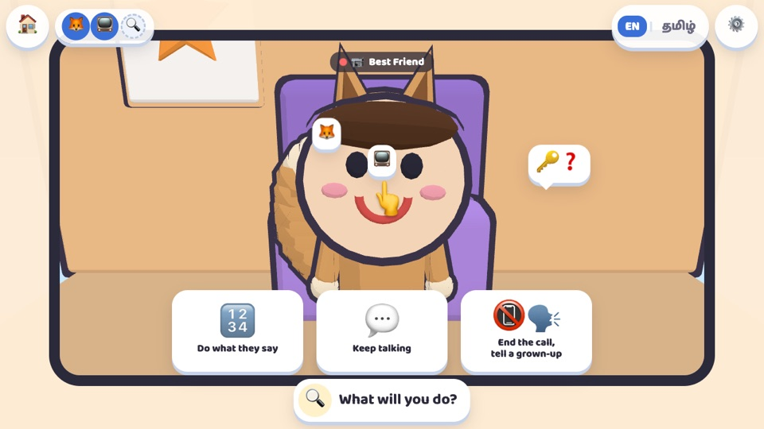
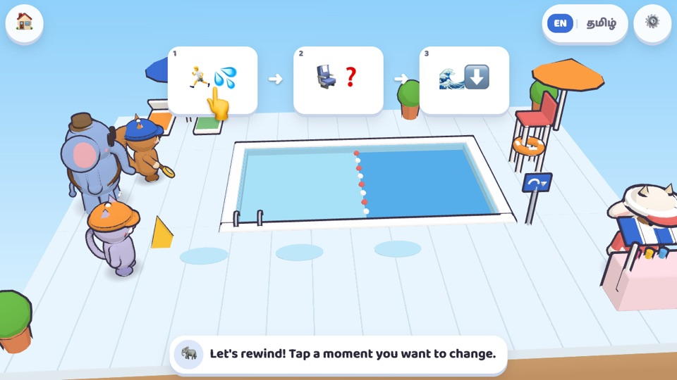
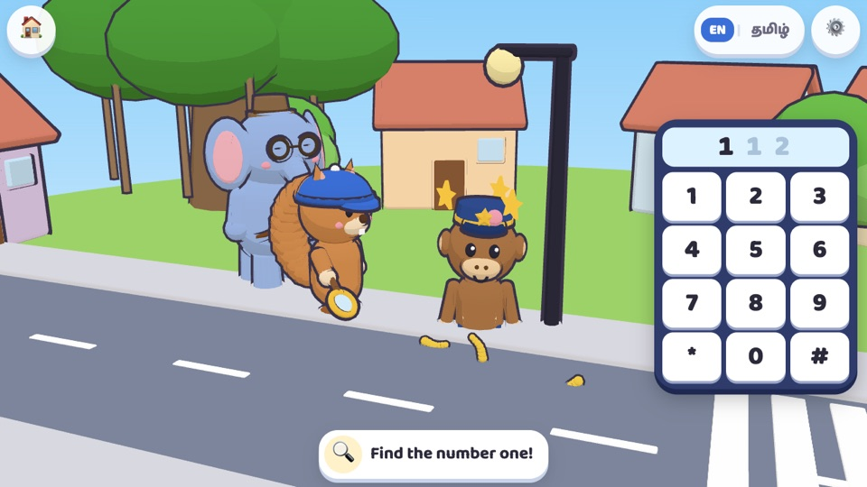

# Safety Detective Town · பாதுகாப்பு துப்பறியும் நகரம்

**English** | [தமிழ்](README.ta.md)

**▶ Play: https://stalinpusparaj.github.io/saftydetectivegame/**

A bilingual (English + தமிழ்) 3D browser game that helps children aged 4–7 *think* about safety: spot real dangers among safe look-alikes, predict what happens next, ask a grown-up when unsure, rewind a mistake, and call 112.

Best on a phone held sideways, in Chrome. No sign-in, no ads.

**Install on Android:** open the link in Chrome, tap ⋮, then **Install app** (or **Add to Home screen**). It opens full-screen in landscape like a normal app.

**Works offline:** after the first visit, the game is saved on the device and plays without internet (for example, installed on a phone in airplane mode).

## Gameplay

*Case 1, The Kitchen Clues: tap a danger to see what could happen, tap again to fix it, and tap a safe look-alike to hear why it is already safe.*

## The cases

| # | Case | Place | What the child does |
|---|---|---|---|
| 1 | The Kitchen Clues | Home | Finds 5 hidden hazards among safe look-alikes, then fixes them |
| 2 | Park Patrol | Park | Predicts what happens next, then picks what Vaalu should do instead |
| 3 | Knock Knock, Who's There? | Home (door) | Looks for clues through the peephole, then calls a grown-up |
| 4 | The Video Call Twin | Home (tablet) | Spots a trickster on a video call asking for secrets |
| 5 | Rewind at the Pool | Pool | Rewinds a story and changes one moment to keep everyone safe |
| 6 | Call 112! | Street | Dials 112, answers the operator, and looks around for landmarks |

Cases unlock in order. Before each new case, a short **Daily Patrol** reviews earlier lessons, focusing on the ones the child found hardest.

## Screenshots

<table>
<tr>
<td width="50%" valign="top"> <b>1 · The Kitchen Clues</b> A hazard found: Inspector Gaja explains why the pan handle is dangerous.</td>
<td width="50%" valign="top"> <b>2 · Park Patrol</b> The scene freezes: what happens next?</td>
</tr>
<tr>
<td width="50%" valign="top"> <b>3 · Knock Knock, Who's There?</b> Clues through the peephole, then choose what to do.</td>
<td width="50%" valign="top"> <b>4 · The Video Call Twin</b> A masked 'best friend' asks for a secret.</td>
</tr>
<tr>
<td width="50%" valign="top"> <b>5 · Rewind at the Pool</b> Rewind the story and change one moment.</td>
<td width="50%" valign="top"> <b>6 · Call 112!</b> Dial 1-1-2 on the big keypad.</td>
</tr>
</table>

## Cast

- **Anil** (squirrel), **Minnu** (kitten), **Kanmani** (calf): the child's detective
- **Inspector Gaja**: wise elephant mentor
- **Constable Vaalu**: clumsy monkey sidekick
- **Nari the Trickster**: a sneaky jackal in disguise. His tail always pokes out.

## For grown-ups

Tap ⚙️, hold the hand button for 3 seconds, then answer the sum to open the **Parent corner**. There you can:

- change language, voice, music, sound effects and reduced motion
- set how many cases can be played per session (1–5)
- see what your child is learning, with tips to talk about at home
- reset progress

The game collects no personal data. After it loads, its only network use is a check for a newer version of the game when it is reopened (at most every 30 minutes), which sends nothing about the player. The first visit also downloads the files it needs for offline play. Progress is saved only in this browser on this device.

## Technical notes

- One file: `index.html`. It uses Three.js 0.160.0 from jsDelivr and the Baloo 2 / Baloo Thambi 2 fonts from Google Fonts. Every character and prop is built from code, with no image, model or audio files.
- **Offline:** `sw.js` caches the page, icons, Three.js and the fonts. The page itself is fetched fresh whenever the device is online, so updates to `index.html` reach players on their next visit. If you change other files (icons, manifest, audio), bump `CACHE_VERSION` in `sw.js` so devices fetch the new copies. When a newer version is published, players see an **update banner** the next time they are in town (never in the middle of a case) and can tap **Update** or dismiss it.
- **Recorded voice-over:** put files at `audio/<lang>/<lineId>.mp3` (for example `audio/ta/intro_kitchen.mp3`), then set `CONFIG.recordedVoice.ta` (or `.en`) to `true` in `index.html`. Until then the game uses the device's text-to-speech, and every line also shows as a caption.
- **Tamil text:** all lines are drafts. A native Tamil speaker who works with young children should review them before release.
- **Developer flags** (only active with `?debug` in the address): `?debug` shows fps and draw calls, `&case=<id>` jumps straight to a case, `&tick` keeps the game running in a hidden tab, `&nostore` simulates blocked storage, and `&sw` turns the offline service worker back on (it is off in debug sessions so tests never see stale files).
