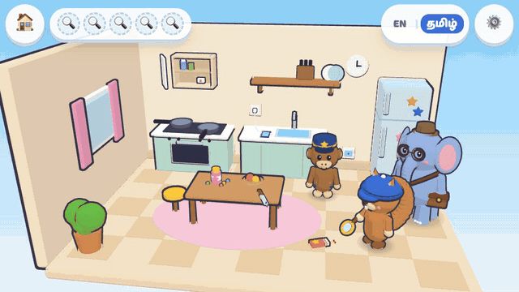
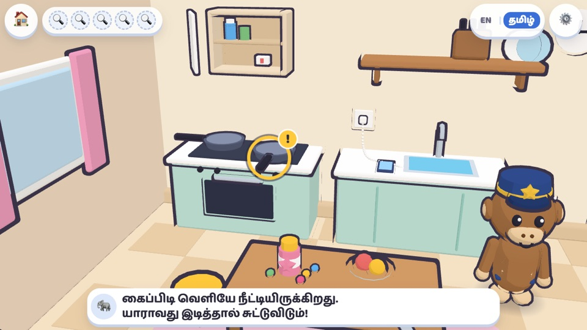
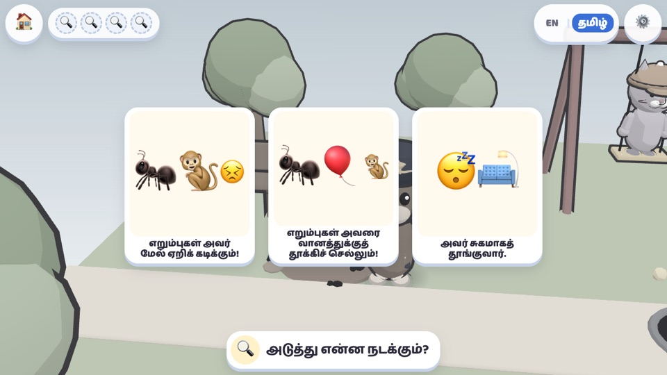
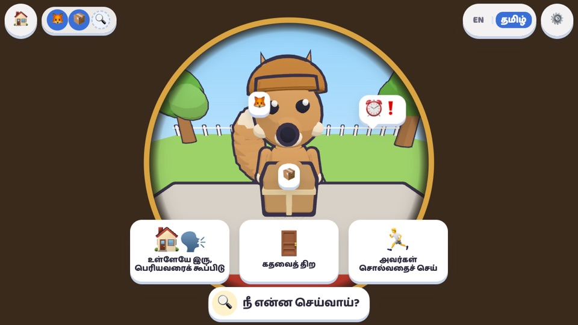
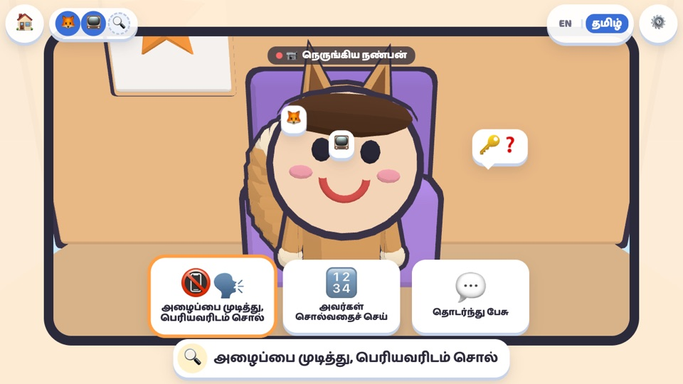
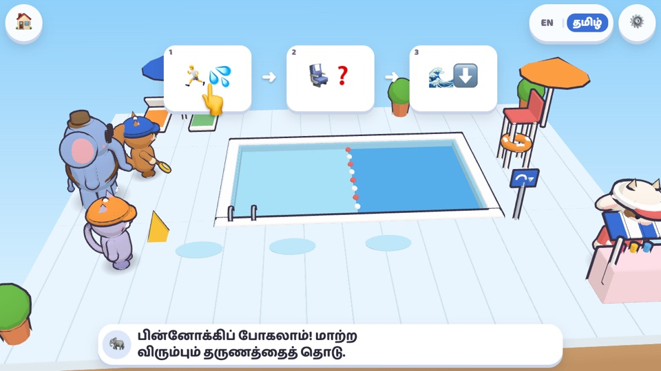
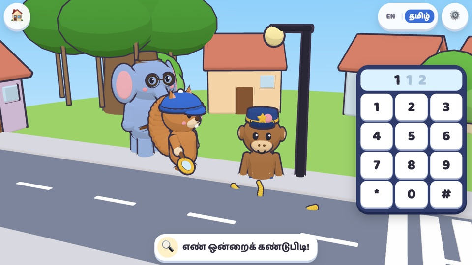

# பாதுகாப்பு துப்பறியும் நகரம் · Safety Detective Town

[English](README.md) | **தமிழ்**

**▶ விளையாட: https://stalinpusparaj.github.io/saftydetectivegame/**

4–7 வயதுக் குழந்தைகள் பாதுகாப்பைப் பற்றி *யோசிக்க* உதவும், ஆங்கிலம் + தமிழ் இருமொழி 3D உலாவி விளையாட்டு. பாதுகாப்பாகத் தோன்றும் பொருட்களுக்கு நடுவே உண்மையான ஆபத்துகளைக் கண்டுபிடிப்பது, அடுத்து என்ன நடக்கும் என்று கணிப்பது, சந்தேகம் வந்தால் பெரியவரிடம் கேட்பது, ஒரு தவறைப் பின்னோக்கிச் சென்று மாற்றுவது, 112-ஐ அழைப்பது ஆகியவற்றை இது பழக்குகிறது.

Chrome-ல், போனைப் பக்கவாட்டில் பிடித்து விளையாடுவது சிறந்தது. உள்நுழைவு இல்லை, விளம்பரம் இல்லை.

**Android-ல் நிறுவ:** Chrome-ல் இணைப்பைத் திறந்து, ⋮ தட்டி, **Install app** (அல்லது **Add to Home screen**) தேர்ந்தெடுங்கள். போன் தமிழில் இருந்தால் இவை தமிழில் தெரியும். விளையாட்டு ஒரு சாதாரண செயலி போல, முழுத் திரையில், பக்கவாட்டில் திறக்கும்.

**இணையம் இல்லாமலும் இயங்கும்:** முதல் முறை திறந்த பிறகு, விளையாட்டு சாதனத்திலேயே சேமிக்கப்படுகிறது. அதனால் இணையம் இல்லாமலும் விளையாடலாம் (உதாரணமாக, நிறுவிய போனை விமானப் பயன்முறையில் வைத்தாலும்).

## விளையாடும் விதம்

*வழக்கு 1, சமையலறை தடயங்கள்: ஆபத்தைத் தொட்டு என்ன நடக்கலாம் என்று பார், மீண்டும் தொட்டுச் சரி செய், பாதுகாப்பாகத் தோன்றும் பொருளைத் தொட்டு அது ஏன் ஏற்கனவே பாதுகாப்பானது என்று கேள்.*

## வழக்குகள்

| # | வழக்கு | இடம் | குழந்தை என்ன செய்கிறது |
|---|---|---|---|
| 1 | சமையலறை தடயங்கள் | வீடு | பாதுகாப்பாகத் தோன்றும் பொருட்களுக்கு நடுவே ஒளிந்திருக்கும் 5 ஆபத்துகளைக் கண்டுபிடித்து, சரி செய்கிறது |
| 2 | பூங்கா ரோந்து | பூங்கா | அடுத்து என்ன நடக்கும் என்று கணித்து, அதற்குப் பதிலாக வாலு என்ன செய்ய வேண்டும் என்று தேர்ந்தெடுக்கிறது |
| 3 | டக் டக், யார் அது? | வீடு (கதவு) | கதவுத் துளை வழியாகத் தடயங்களைத் தேடி, பெரியவரைக் கூப்பிடுகிறது |
| 4 | வீடியோ அழைப்பு இரட்டை | வீடு (டேப்லெட்) | வீடியோ அழைப்பில் ரகசியங்களைக் கேட்கும் ஏமாற்றுக்காரரைக் கண்டுபிடிக்கிறது |
| 5 | குளத்தில் பின்னோக்கி | நீச்சல் குளம் | ஒரு கதையைப் பின்னோக்கிச் சென்று, எல்லோரும் பாதுகாப்பாக இருக்க ஒரு தருணத்தை மாற்றுகிறது |
| 6 | 112-க்கு அழை! | தெரு | 112-ஐ அழைத்து, உதவியாளரின் கேள்விகளுக்குப் பதில் சொல்லி, சுற்றியுள்ள அடையாளங்களைப் பார்க்கிறது |

வழக்குகள் வரிசையாகத் திறக்கும். ஒவ்வொரு புதிய வழக்குக்கும் முன், சிறிய **தினசரி ரோந்து** முந்தைய பாடங்களை நினைவூட்டுகிறது. குழந்தைக்குக் கடினமாக இருந்த பாடங்களுக்கு அது அதிக கவனம் தருகிறது.

## திரைக்காட்சிகள்

<table>
<tr>
<td width="50%" valign="top"> <b>1 · சமையலறை தடயங்கள்</b> ஆபத்து கண்டுபிடிக்கப்பட்டது: பாத்திரக் கைப்பிடி ஏன் ஆபத்து என்று இன்ஸ்பெக்டர் கஜா விளக்குகிறார்.</td>
<td width="50%" valign="top"> <b>2 · பூங்கா ரோந்து</b> காட்சி உறைகிறது: அடுத்து என்ன நடக்கும்?</td>
</tr>
<tr>
<td width="50%" valign="top"> <b>3 · டக் டக், யார் அது?</b> கதவுத் துளை வழியாகத் தடயங்கள், பிறகு என்ன செய்வது என்று தேர்வு.</td>
<td width="50%" valign="top"> <b>4 · வீடியோ அழைப்பு இரட்டை</b> முகமூடி அணிந்த 'நெருங்கிய நண்பன்' ஒரு ரகசியத்தைக் கேட்கிறான்.</td>
</tr>
<tr>
<td width="50%" valign="top"> <b>5 · குளத்தில் பின்னோக்கி</b> கதையைப் பின்னோக்கிச் சென்று ஒரு தருணத்தை மாற்று.</td>
<td width="50%" valign="top"> <b>6 · 112-க்கு அழை!</b> பெரிய எண் பலகையில் 1-1-2 அழுத்து.</td>
</tr>
</table>

## கதாபாத்திரங்கள்

- **அணில்** (அணில்), **மின்னு** (பூனைக்குட்டி), **கண்மணி** (கன்றுக்குட்டி): குழந்தை தேர்ந்தெடுக்கும் துப்பறிவாளர்
- **இன்ஸ்பெக்டர் கஜா**: அறிவுரை சொல்லும் ஞானமுள்ள யானை
- **கான்ஸ்டபிள் வாலு**: அடிக்கடி தடுமாறும், வேடிக்கையான குரங்கு உதவியாளர்
- **ஏமாற்றுக்கார நரி**: மாறுவேடத்தில் வரும் தந்திரக்கார நரி. அவருடைய வால் எப்போதும் வெளியே தெரியும்.

## பெரியவர்களுக்கு

⚙️ தட்டி, கை பொத்தானை 3 வினாடிகள் அழுத்திப் பிடித்து, கணக்குக்குப் பதில் சொன்னால் **பெற்றோர் பகுதி** திறக்கும். அங்கே நீங்கள்:

- மொழி, குரல், இசை, ஒலி விளைவுகள், குறைந்த அசைவு ஆகியவற்றை மாற்றலாம்
- ஒரு அமர்வில் எத்தனை வழக்குகள் விளையாடலாம் என்று அமைக்கலாம் (1–5)
- உங்கள் குழந்தை என்ன கற்கிறது என்று பார்க்கலாம்; வீட்டில் பேச வேண்டிய குறிப்புகளும் உண்டு
- முன்னேற்றத்தை அழிக்கலாம்

இந்த விளையாட்டு எந்தத் தனிப்பட்ட தகவலையும் சேகரிப்பதில்லை. திறந்த பிறகு அது இணையத்தைப் பயன்படுத்துவது ஒரே ஒரு காரணத்துக்காக மட்டும்: மீண்டும் திறக்கப்படும்போது விளையாட்டின் புதிய பதிப்பு இருக்கிறதா என்று பார்க்க (அதிகபட்சம் 30 நிமிடத்துக்கு ஒருமுறை). அதில் குழந்தையைப் பற்றி எதுவும் அனுப்பப்படுவதில்லை. இணையம் இல்லாமல் விளையாடத் தேவையான கோப்புகளை முதல் முறையே பதிவிறக்குகிறது. முன்னேற்றம் இந்தச் சாதனத்தின் இந்த உலாவியில் மட்டுமே சேமிக்கப்படுகிறது.

## தொழில்நுட்பக் குறிப்புகள்

- ஒரே கோப்பு: `index.html`. இது jsDelivr-லிருந்து Three.js 0.160.0-ஐயும், Google Fonts-லிருந்து Baloo 2 / Baloo Thambi 2 எழுத்துருக்களையும் பயன்படுத்துகிறது. ஒவ்வொரு கதாபாத்திரமும் பொருளும் நிரலிலேயே உருவாக்கப்படுகின்றன; படம், 3D மாடல், ஒலிக் கோப்புகள் எதுவும் இல்லை.
- **இணையம் இல்லாமல்:** `sw.js` பக்கத்தையும், ஐகான்களையும், Three.js-ஐயும், எழுத்துருக்களையும் சேமிக்கிறது. சாதனம் இணையத்தில் இருக்கும்போது பக்கம் ஒவ்வொரு முறையும் புதிதாகப் பெறப்படுகிறது. அதனால் `index.html` மாற்றங்கள் அடுத்த முறை விளையாடுபவர்களைச் சென்றடையும். மற்ற கோப்புகளை (ஐகான்கள், manifest, ஒலி) மாற்றினால், `sw.js`-ல் உள்ள `CACHE_VERSION`-ஐ உயர்த்துங்கள்; அப்போது சாதனங்கள் புதிய நகல்களைப் பெறும். புதிய பதிப்பு வெளியானால், அடுத்த முறை குழந்தை நகரத்தில் இருக்கும்போது (வழக்கின் நடுவில் ஒருபோதும் இல்லை) **புதுப்பிப்பு அறிவிப்பு** தோன்றும். **புதுப்பி** தட்டலாம் அல்லது அதை மூடலாம்.
- **பதிவு செய்த குரல்:** கோப்புகளை `audio/<lang>/<lineId>.mp3` என்ற இடத்தில் வையுங்கள் (உதாரணம்: `audio/ta/intro_kitchen.mp3`). பிறகு `index.html`-ல் `CONFIG.recordedVoice.ta` (அல்லது `.en`) என்பதை `true` ஆக்குங்கள். அதுவரை சாதனத்தின் உரை-ஒலி (text-to-speech) குரல் பயன்படும்; ஒவ்வொரு வரியும் எழுத்தாகவும் திரையில் தோன்றும்.
- **தமிழ் உரை:** விளையாட்டின் தமிழ் வரிகளும், இந்தப் பக்கமும் வரைவுகள். வெளியிடும் முன், சிறு குழந்தைகளுடன் பழகும் தாய்மொழித் தமிழர் ஒருவர் அவற்றைச் சரிபார்க்க வேண்டும்.
- **டெவலப்பர் அமைப்புகள்** (முகவரியில் `?debug` இருந்தால் மட்டும்): `?debug` fps, draw calls எண்ணிக்கையைக் காட்டும்; `&case=<id>` நேரடியாக ஒரு வழக்குக்குச் செல்லும்; `&tick` மறைந்த டேபிலும் விளையாட்டை ஓட வைக்கும்; `&nostore` சேமிப்பு தடுக்கப்பட்டதைப் போலச் சோதிக்கும்; `&sw` இணையமில்லா service worker-ஐ மீண்டும் இயக்கும் (சோதனைகளில் பழைய கோப்புகள் வராமல் இருக்க, debug-ல் அது அணைந்திருக்கும்).

## உரிமம்

பதிப்புரிமை (c) 2026 stalinpusparaj. அனைத்து உரிமைகளும் பாதுகாக்கப்பட்டவை. விளையாட்டை விளையாடலாம், நிரலைப் பார்க்கலாம். ஆனால் அனுமதியின்றி நிரலையோ, கதாபாத்திரங்களையோ, கதைகளையோ நகலெடுக்கவோ, மாற்றவோ, மீண்டும் பயன்படுத்தவோ கூடாது. முழு விவரங்கள் [LICENSE](LICENSE) கோப்பில் (ஆங்கிலத்தில்) உள்ளன.
